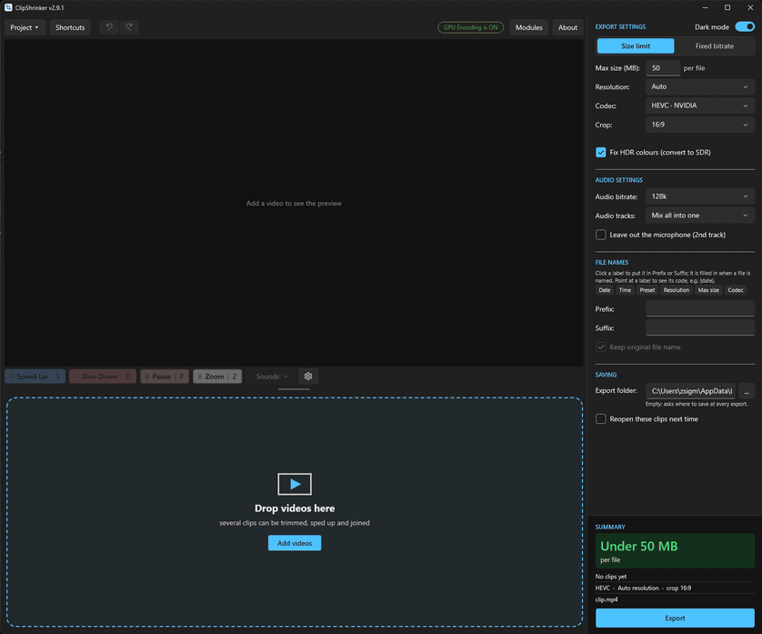
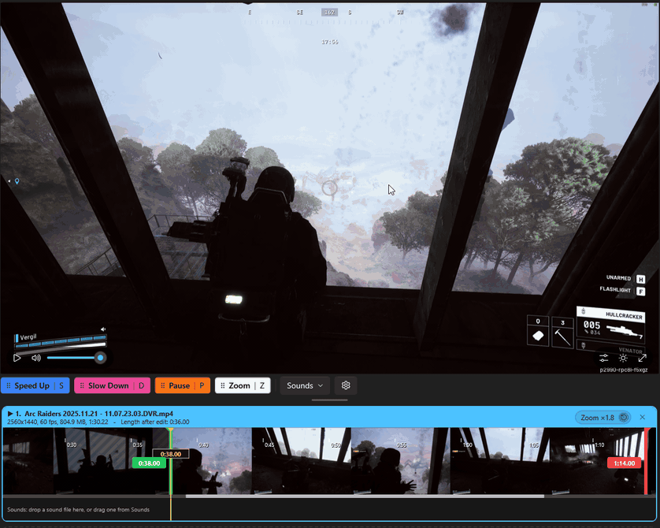

# ClipShrinker

**Trim, join and shrink game clips to an exact file size on your graphics card.**

**[Download ClipShrinker](../../releases/latest)** (portable zip, nothing to install) · [What's new](dist/CHANGELOG.txt)

A 1:30 ShadowPlay clip at 1440p (805 MB), trimmed to 36 seconds, came out at 48 MB with the 50 MB limit, in 8 seconds on an RTX 5070.

Set a size limit (e.g. 50 MB for Discord), trim on a thumbnail timeline, join clips if you want, then export. ClipShrinker re-encodes on your graphics card and tries again until the file lands just under the limit. Everything runs on your PC; nothing is uploaded.

## What it does
- **Exact file size.** Set a limit and the export lands just under it. Or pick a fixed bitrate.
- Trim on a thumbnail timeline, join several clips, with a transition between them.
- Keep game and mic audio as separate tracks, or mix them.
- Crop ultrawide gameplay to 16:9, 21:9, 16:10 or 4:3.
- HEVC or H.264 on NVIDIA, AMD or Intel graphics. HDR clips are converted to normal colours.
- Dark and light theme, projects you can save and reopen, and every shortcut can be changed (F1 lists them).

## Extras you can switch off
Each extra is a module: switch it off or delete it in **Modules** if you don't need it.
- Speed-up, slow motion (smooth frame interpolation), pause and zoom sections on the timeline
- Sounds: drop your own sound effects on a clip's Sounds lane, or drag them from your collection
- Picture: brightness, contrast, saturation, white balance and a denoiser
- Sound: a five-band equalizer and volume
- Bitrate presets for clips you export with a fixed bitrate
- AI editing with Claude Code, off until you install it (see [below](#ai-editing-optional))

## Install

1. Download the zip from the [latest release](../../releases/latest).
2. Unzip it anywhere and double-click `ClipShrinker.exe`. Keep the `library` and `modules` folders next to the exe. Windows may show a SmartScreen warning because the exe is not code-signed: **More info → Run anyway**.

To update, unzip the new version over the old folder. Your settings, modules and sounds are kept.

**Needs:** Windows 10/11 (64-bit). A recent NVIDIA (GTX 10xx or newer), AMD or Intel graphics driver makes it fast; without one, export still works on the CPU, more slowly. The "GPU Encoding is ON/OFF" badge in the app shows which one you have.

## AI editing (optional)

Connect ClipShrinker to [Claude Code](https://claude.com/claude-code) and describe the edit, e.g. *"trim to the action, slow down the first bullet exchange and add a satisfying sound effect when the fight is won"*. Claude looks at frames of the clip, then works on the clips open in the app. Every change shows on the timeline right away and Ctrl+Z undoes it. It can also work without the app open and batch trim several clips from one prompt.

Claude can:
- find moments by what happens on screen, by loud peaks (shots, explosions) or by what is said
- trim clips and add speed, pause and zoom sections
- add sound effects from your collection, or download one from a free sound site
- change the picture and export settings, and export when you ask
- write subtitles (.srt) from speech and context, and translate them

Set it up in **Modules > AI editing > Install** (about 60 MB, plus 550 MB for speech to text), then click **Connect to Claude Code** and start a new Claude Code session. Needs Claude Code and a Claude subscription or API account.

> [!NOTE]
> AI editing sends frames, speech, file names and settings of the clips Claude works on to Anthropic. It stays off until you switch it on.

## More

- [User guide](dist/README.txt) (also in the app's About window) · [Changelog](dist/CHANGELOG.txt)

Details: graphics cards, denoiser and speech to text

- Export uses NVIDIA (NVENC), AMD (AMF) or Intel (Quick Sync). Without one, Windows' own encoder is used, on the CPU as a last resort (slower, H.264 only).
- The Picture module's denoiser uses OpenCL, which also needs a graphics card with a recent driver; otherwise it runs on the CPU, which is much slower.
- AI editing's speech to text is much faster on a graphics card with Vulkan support (most NVIDIA, AMD and Intel cards); without one it runs on the CPU.
- The release zip contains one self-contained `ClipShrinker.exe` (.NET built in), a slim LGPL ffmpeg build and RIFE, so it runs on a PC with nothing installed. If ffmpeg is missing, the program offers to download it once. AI editing is not in the zip: the app downloads it from the [ai-editing](../../releases/tag/ai-editing) release when you install it.

For developers: repository layout and docs

- [docs/DEVELOPMENT.md](docs/DEVELOPMENT.md) - how the repo, builds and tests work
- [docs/mcp-agent-research.md](docs/mcp-agent-research.md) - how AI editing was designed

Since 2.0.0 ClipShrinker is a C# / .NET 10 WPF app. The Python 1.0.x version is in the
[v1.0.8](../../tree/v1.0.8) tag.

| Path | Contents |
|---|---|
| `src/ClipShrinker.App/` | The WPF application (windows, view models, preview) |
| `src/ClipShrinker.Core/` | Export engine, ffmpeg commands, projects, settings and the AI editing tools |
| `src/ClipShrinker.Cli/` | Command-line front end used by the tests, and the AI editing helper (`clipshrinker mcp`) |
| `modules/` | Version and changelog of each built-in module |
| `tests/` | xUnit tests and the golden fixtures from 1.0.8 |
| `tools/make_release.ps1` | Builds the exe and the release zip |
| `tools/make_ai_module.ps1` | Builds the AI editing download (helper, speech ffmpeg, models) |
| `tools/reference/`, `tools/dump_*.py` | Frozen 1.0.8 source and the scripts that make the fixtures |
| `tools/ffmpeg-build/` | Recipe for the slim ffmpeg build |
| `dist/` | The text files shipped in the zip (README, CHANGELOG, licenses) |

Third-party licences

Third-party parts: [THIRD-PARTY-NOTICES.txt](dist/THIRD-PARTY-NOTICES.txt). ffmpeg is a slim LGPL build of the [FFmpeg](https://ffmpeg.org) project
([settings](dist/ffmpeg-build-settings.txt), [license](dist/ffmpeg-LICENSE.txt)). It includes the Khronos OpenCL loader for the GPU denoiser,
which is Apache 2.0 ([license](dist/OpenCL-ICD-Loader-LICENSE.txt)). It also includes AMD's AMF headers ([license](dist/AMF-LICENSE.txt)) and Intel's oneVPL dispatcher ([license](dist/oneVPL-LICENSE.txt)), both MIT.
RIFE (ncnn) keeps its own license.
The AI editing download adds an ffmpeg build with [whisper.cpp](https://github.com/ggml-org/whisper.cpp) (MIT, license included in the download), the Whisper large-v3-turbo speech model (MIT, OpenAI) and the Silero VAD model (MIT).

MIT, see [LICENSE](LICENSE). Made by Vergil, built together with [Claude](https://claude.com).
